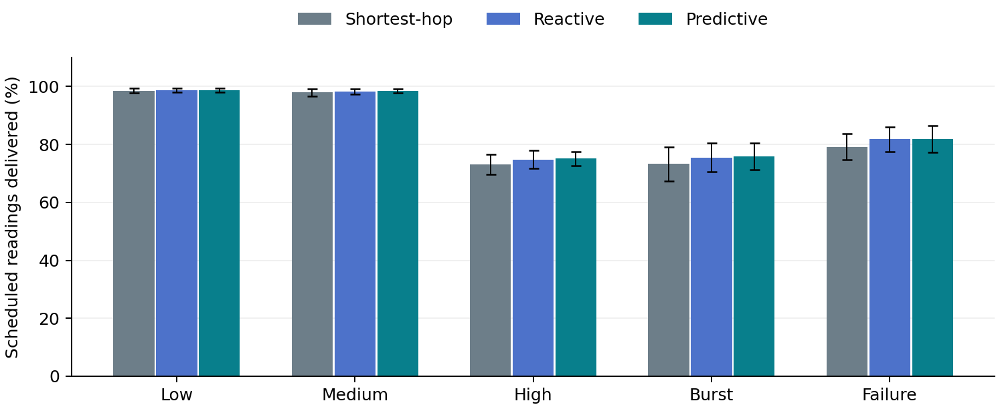

# Predictive Adaptive Mesh Routing Protocol for Energy-Constrained IoT Networks

**BCSE308P Computer Networks Lab — Innovative Evaluation Practices**  
**VIT Vellore | Fall Semester 2026–2027 | Slot F2 | Team 19**

## 1. Project Overview

This project implements a network simulator and interactive dashboard for studying energy-aware routing in an IoT mesh network.

Battery-powered sensors generate readings and forward packets through neighboring sensors to a gateway. Frequently used relay nodes can exhaust their batteries early, affecting communication from multiple upstream sensors.

The proposed **Predictive Adaptive Mesh Routing policy (PAMR)** estimates future remaining energy using recent energy consumption. It combines the forecast with link reliability and queue occupancy to select a suitable next hop.

The implementation compares three routing strategies:

1. Shortest-hop routing.
2. Reactive energy-aware routing.
3. Predictive adaptive routing.

The project includes complete source code, saved simulation configuration and topology, automated tests, repeated-run results, graphs, a report, and a presentation.

## 2. Team Members and Responsibilities

Members are listed in register-number order.

| Register Number | Member | Responsibility |
| --- | --- | --- |
| 24BCE0817 | **Siddhi Gulati** | Network simulation and repository integration: topology, packet generation, forwarding, queues, retries, battery accounting, and simulation configuration |
| 24BCT0084 | **Harshitha Nethi** | Prediction and routing: EWMA estimation, neighbor advertisements, energy forecasting, routing scores, parent selection, loop prevention, and hysteresis |
| 24BKT0146 | **Saamiya Siddique** | Dashboard and evaluation: HTTP API, visualization, experiments, metrics, screenshots, results analysis, and submission evidence |

### Module Ownership

| Member | Main Files and Functions |
| --- | --- |
| Siddhi Gulati | `Config`, `make_topology`, `generate`, `forward`, `spend`, and `step` in `simulator.py`; `simulation/` |
| Harshitha Nethi | `Observation`, `advertise`, `update_predictor`, `score`, `candidates`, and `choose_parent` in `simulator.py`; `MODEL.md` |
| Saamiya Siddique | `app.py`, `static/`, `experiments.py`, screenshot capture script, `results/`, and supporting documents |

Siddhi and Harshitha coordinate changes to their shared file, `simulator.py`. All members should understand the complete algorithm and experimental results.

## 3. Problem Statement and Objectives

Current battery level alone does not reveal how quickly a relay is consuming energy. A node with more energy now may become unsuitable sooner than another node with a lower drain rate.

The project investigates whether short-horizon energy prediction improves routing decisions beyond current-energy awareness.

### Objectives

- Simulate multi-hop sensor-to-gateway communication.
- Model finite batteries, packet queues, losses, retries, and failures.
- Estimate energy consumption using historical observations.
- Forecast future energy and adapt next-hop selection.
- Prevent forwarding loops and reduce unnecessary route changes.
- Compare the proposed mechanism against two baselines.
- Preserve source code and experimental evidence for verification.

## 4. Implemented Features

- Configurable static physical mesh.
- Battery-powered sensors and one externally powered gateway.
- Packet generation and hop-by-hop forwarding.
- Finite queues, transmission losses, bounded retries, and packet TTL.
- Energy accounting for transmission, reception, idle operation, and control traffic.
- Local neighbor advertisements with timestamps and expiry.
- EWMA-based energy-drain estimation.
- Forecast-based parent selection and route-change hysteresis.
- Steady traffic, temporary bursts, and injected relay failure.
- Interactive network replay and node inspection.
- Routing decision and failure logs.
- Comparison tables and performance graphs.
- CSV and JSON exports.
- Automated tests and reproducible repeated experiments.

## 5. Software and Setup Requirements

| Requirement | Details |
| --- | --- |
| Python | **Python 3.10 or later** |
| Git | Required for cloning and contributing |
| Browser | Modern Firefox, Chrome, Edge, or equivalent |
| Operating System | Linux, macOS, or Windows with Python; dashboard also demonstrated on NixOS |
| Development Tool | VS Code or another Python-capable editor; terminal execution is sufficient |
| Core Dependencies | Python standard library only |
| Optional Screenshot Dependencies | Listed in `requirements-evidence.txt` |
| Optional Report Dependencies | Listed in `requirements-report.txt` |
| Database / API Keys | Not required |
| Physical Sensors / GPU | Not required |
| Cisco Packet Tracer | Not required for this implementation |

Internet access is needed to clone the repository and install optional dependencies. The main application runs locally without internet after downloading.

**No third-party Python packages need to be installed to run the simulator, dashboard server, experiments, or unit tests.**

## 6. Installation and Execution

### 6.1 Clone the Repository

If GitHub SSH authentication is configured:

```bash
git clone git@github.com:cookiea11/F2_Team19.git
cd F2_Team19
```

Alternatively, download the repository ZIP, extract it, and open a terminal inside the folder containing `app.py` and `README.md`.

### 6.2 Check Python and Git

```bash
python3 --version
git --version
```

On Windows:

```powershell
py -3 --version
git --version
```

### 6.3 Create a Virtual Environment

#### Linux, macOS, and NixOS

```bash
python3 -m venv .venv
source .venv/bin/activate
```

#### Windows PowerShell

```powershell
py -3 -m venv .venv
.\.venv\Scripts\Activate.ps1
```

If PowerShell prevents activation, use the virtual environment’s interpreter directly:

```powershell
.\.venv\Scripts\python.exe app.py
```

The following commands use `python` after activating the environment.

### 6.4 Run the Tests

```bash
python -m unittest -v
```

The supplied verification record contains **14 passing automated checks**.

### 6.5 Start the Dashboard

```bash
python app.py
```

Open:

**http://127.0.0.1:8000**

Keep the terminal running while using the dashboard. Press **Ctrl+C** to stop the server.

If the port is occupied:

```bash
python app.py --port 8001
```

Then open:

**http://127.0.0.1:8001**

### 6.6 Alternative Launchers

Windows:

```text
launch.bat
```

Linux/macOS:

```bash
sh launch.sh
```

### 6.7 Offline Demonstration

Open `static/index.html` directly in a browser, keeping `demo_data.js` in the same directory.

The bundled example supports replay, policy switching, inspection, and exports. It is a **precomputed demonstration**. Start the Python server to calculate fresh parameter settings.

## 7. Dashboard Demonstration

1. Click **Run all three strategies** to compute a fresh comparison.
2. Use **Play**, **Step**, or the time slider to inspect network evolution.
3. Switch between **Shortest-hop**, **Reactive**, and **Predictive**.
4. Click a sensor to inspect its battery, forecast, drain rate, queue, and route.
5. Read the routing decision and failure logs.
6. Inspect the graphs and final comparison table.
7. Change the node count, scenario, seed, horizon, or smoothing factor and run again.
8. Export the comparison using **Export CSV** or **Export JSON**.

The upper metrics follow the selected replay time. The final comparison table shows the complete run.

The simulation is computed first and then replayed. The animation does not represent live hardware telemetry.

See [DEMO_SCRIPT.md](DEMO_SCRIPT.md) for the demonstration sequence and [VIVA_GUIDE.md](VIVA_GUIDE.md) for fundamentals and questions.

## 8. Routing Mechanism

### 8.1 Baseline Strategies

| Strategy | Selection Rule |
| --- | --- |
| Shortest-hop | Use a fresh lower-level neighbor on the initial minimum-hop scaffold, with link quality as a tie-breaker |
| Reactive energy-aware | Score candidates using current advertised battery energy, link loss, and queue occupancy |
| Predictive adaptive | Replace current energy in the same score with estimated future energy |

The reactive baseline helps isolate the contribution of prediction.

### 8.2 Energy Prediction

A sensor samples its energy every five seconds:

```text
recent_drain =
    (previous_sample_energy - current_energy) / elapsed_seconds

smoothed_drain =
    alpha × recent_drain
    + (1 - alpha) × previous_smoothed_drain
```

For a neighbor advertisement:

```text
future_energy =
    max(0, advertised_energy - advertised_drain × (H + age))
```

Where:

- `H` is the forecast horizon.
- `age` is the advertisement’s age.
- Default `alpha` is `0.35`.
- Default `H` is `40 seconds`.

The predictor uses historical consumption. It does not read future simulation values or train a neural network.

### 8.3 Routing Score

```text
energy_risk = 1 - min(1, future_energy / battery_capacity)

link_loss = 1 - link_success_probability

queue_fraction =
    min(1, advertised_queue_length / queue_limit)

cost =
    0.65 × energy_risk
    + 0.20 × link_loss
    + 0.15 × queue_fraction
```

Lower cost is preferable.

A node retains its valid current parent unless another candidate improves cost by more than `0.06`. This switching margin is hysteresis.

### 8.4 Loop Prevention

A sensor forwards only to an eligible neighbor with a strictly lower initial gateway level.

Levels decrease on every hop, preventing forwarding loops. However, fixed levels also exclude some possible detours after failures.

For the exact model and edge cases, see [MODEL.md](MODEL.md).

## 9. Simulation Configuration and Files

### Default Parameters

| Parameter | Default |
| --- | --- |
| Sensor Count | 30 sensors plus gateway 0 |
| Duration | 400 seconds |
| Simulation Slot | One-second illustrative service slot |
| Link Radius | 32 abstract coordinate units |
| Ordinary Sensor Capacity | Seeded between 85 and 115 EU |
| Sensor 1 Capacity | 38 EU |
| Data Transmission Cost | 0.10 EU per powered attempt |
| Data Reception Cost | 0.05 EU per powered attempt |
| Idle Cost | 0.005 EU per live sensor per slot |
| Control Transmission / Reception | 0.02 / 0.005 EU |
| Queue Limit | 20 packets |
| Maximum Attempts | 3 per current hop |
| Packet TTL | 100 seconds |
| Energy Sampling / Routing Decision | Every 5 seconds |
| Status Advertisement | Every 10 seconds |
| Observation Expiry | Older than 20 seconds |
| Forecast Horizon | 40 seconds |
| EWMA Alpha | 0.35 |
| Dashboard Example Seed | 42 |

**EU means illustrative energy units.** These values are not calibrated joules, mAh, or measured device lifetimes.

### Saved Simulation Files

| File | Purpose |
| --- | --- |
| [F2_Team19_Config.json](simulation/F2_Team19_Config.json) | Complete simulation and policy parameters |
| [F2_Team19_Topology.json](simulation/F2_Team19_Topology.json) | Nodes, coordinates, initial levels, capacities, links, and link qualities |
| [F2_Team19_Simulation.json](results/F2_Team19_Simulation.json) | Complete default comparison, histories, events, and metrics |

Reproduce the saved simulation:

```bash
python scripts/run_simulation.py
```

This regenerates the result and named topology from the configuration.

This project uses a custom Python simulator. Therefore, a Cisco Packet Tracer `.pkt` file is not applicable. The source, JSON configuration/topology, and results are the simulation resources supplied for verification.

## 10. Testing and Performance Evaluation

### 10.1 Correctness Testing

```bash
python -m unittest -v
```

Checks cover:

- Deterministic reproducibility.
- Packet and energy conservation.
- Loop-free parent selection.
- Predictor arithmetic and forecast horizons.
- Stale advertisements and hysteresis.
- Input validation and serialization.
- Real local HTTP requests.

Packet accounting follows:

```text
offered = generated + source_unavailable

generated = delivered + dropped + pending
```

Each sensor’s initial capacity equals remaining energy plus accounted consumption.

Recorded output is available in [F2_Team19_TestResults.txt](tests/F2_Team19_TestResults.txt).

### 10.2 Repeated Experiments

```bash
python experiments.py --seeds 10
```

| Case | Scenario | Base Generation Probability per Sensor per Second |
| --- | --- | ---: |
| S1 | Low steady load | 0.015 |
| S2 | Medium steady load | 0.030 |
| S3 | High steady load | 0.060 |
| S4 | Burst: generation triples during the middle third | 0.030 |
| S5 | Relay 1 forced offline at 200 seconds if alive | 0.030 |

Five cases × ten matched seeds × three strategies produce **150 simulation runs**.

Repeated experiments use seeds **0–9**. The dashboard’s seed **42** is a separate demonstration.

Results are written to:

- [results/experiments.csv](results/experiments.csv)
- [results/summary.json](results/summary.json)

Run a smaller check without overwriting the full submission results:

```bash
python experiments.py --scenario burst --seeds 3 --out results/burst_check
```

Accepted case names include `low_load`, `medium_load`, `high_load`, `burst`, and `failure`. The `steady` alias means medium load.

### 10.3 Performance Metrics

| Metric | Definition |
| --- | --- |
| Demand Delivery Ratio | Delivered packets / all scheduled readings, including demand at offline sources |
| Packet Delivery Ratio | Delivered packets / packets generated by live sources |
| Mean Delay | Creation-to-gateway time over delivered packets |
| Energy per Delivered Packet | Total modeled sensor energy spent / delivered count |
| First Battery Death | Earliest depletion, excluding injected failure |
| Route Changes | Parent changes after initial assignment |
| Forecast MAE | Mean absolute error of matured energy forecasts |

Pending packets remain separate from terminal drops. No observed battery death within the run is a censored observation, not infinite lifetime.

The included GitHub Actions workflow is configured to run tests and a small repeatability experiment. Check its actual status on GitHub.

## 11. Expected Results

Mean ± sample standard deviation of **demand delivery in percent**, across ten matched seeds:

| Scenario | Shortest-hop | Reactive | Predictive |
| --- | ---: | ---: | ---: |
| Low Load | 98.52 ± 0.84 | 98.61 ± 0.70 | 98.68 ± 0.80 |
| Medium Load | 97.92 ± 1.21 | 98.22 ± 1.03 | 98.50 ± 0.64 |
| High Load | 73.08 ± 3.46 | 74.82 ± 3.11 | 75.05 ± 2.42 |
| Burst | 73.26 ± 5.88 | 75.51 ± 5.03 | 75.85 ± 4.62 |
| Relay Failure | 79.15 ± 4.54 | 81.74 ± 4.31 | 81.83 ± 4.71 |



At high load, predictive mean delivery exceeds shortest-hop by **1.97 percentage points**. The additional gain beyond reactive routing is smaller.

Prediction does not improve every metric or run. In the default seed-42 burst case, predictive delivery is **80.94%**, compared with **82.32%** for reactive routing.

These are descriptive synthetic results. No formal statistical-significance, optimality, or universal-superiority claim is made.

Plots in `results/figures/` are measurement figures, not dashboard screenshots. Regenerating experiment CSVs does not automatically update the saved report or presentation.

## 12. Dashboard Screenshots in the Presentation

Add genuine dashboard captures to `docs/F2_Team19_PPT.pptx` before submission.
Include the default network, comparison results, relay failure, and a parameter
change. Review their inclusion and readability manually.

There is no separately tracked screenshots folder. The optional
`scripts/capture_screenshots.py` helper generates local captures in `screenshots/`,
which is ignored by Git. Embed the captures in the presentation and commit the PPTX.

## 13. Repository Organization

| Path | Contents |
| --- | --- |
| `simulator.py` | Network state, topology, forwarding, energy, routing, and prediction |
| `app.py` | Local HTTP server and input validation |
| `experiments.py` | Repeated experiments and statistical summaries |
| `static/` | Complete dashboard and offline example |
| `simulation/` | Saved configuration and topology |
| `results/` | Raw results, summaries, demonstration data, and graphs |
| `test_simulator.py` | Simulator correctness checks |
| `test_http.py` | HTTP integration checks |
| `tests/` | Recorded test output |
| `scripts/` | Simulation execution, screenshot capture, report generation, and submission checks |
| `docs/` | Report, presentation, speaker notes, and submission guidance |
| `MODEL.md` | Exact model, equations, and assumptions |
| `VIVA_GUIDE.md` | Fundamentals, worked example, and viva answers |
| `DEMO_SCRIPT.md` | Demonstration sequence |
| `team.json` | Team and course metadata |
| `requirements*.txt` | Core requirements note and optional dependencies |

Optional report regeneration:

```bash
python -m pip install -r requirements-report.txt
python scripts/build_report.py
```

Check the regenerated typography and layout. This script does not regenerate the PPTX.

## 14. Submission Requirements

The submission prefix is **`F2_Team19`**, following the prescribed `Slot Number_Team Number` convention.

| VTOP Assignment | Deliverable |
| --- | --- |
| Assignment 8 — Project Report | [F2_Team19_Report.pdf](docs/F2_Team19_Report.pdf) |
| Assignment 9 — Project Presentation | [F2_Team19_PPT.pptx](docs/F2_Team19_PPT.pptx) |
| Assignment 10 — GitHub Repository Link | This repository’s verified, faculty-accessible URL |

Named report, presentation, simulation, and screenshot artifacts use the required prefix. Python source files retain their executable module names.

The repository includes source and supporting resources rather than screenshots or executables alone.

### Final Verification

```bash
python -m unittest -v
python scripts/check_submission.py
```

The submission checker verifies selected files, result-row counts, and slide count. It does not assess screenshot content, typography, signatures, GitHub permissions, or VTOP submission status.

Before submission:

- Verify execution on the presentation laptop.
- Demonstrate baseline versus proposed routing and a live parameter change.
- Add genuine dashboard screenshots to the presentation, inspect them, and commit the PPTX.
- Review the report and add signatures where required.
- Check exact report typography.
- Open and inspect every presentation slide.
- Verify faculty access, including permissions if the repository is private.
- Submit each deliverable to the correct VTOP assignment.
- Ensure all members can explain their assigned module and the overall mechanism.

The supplied PDF embeds **Nimbus Roman**, a Times-compatible substitute. For exact Times New Roman compliance, use `docs/F2_Team19_Report_Print.html` on a machine with that font or rebuild using genuine fonts. Verify pagination and contents-page numbers after export.

## 15. Troubleshooting

| Issue | Resolution |
| --- | --- |
| `python` not found | Use `python3` on Linux/macOS or `py -3` on Windows |
| `app.py` not found | Enter the inner project folder containing the source files |
| Browser cannot connect | Keep the server running and use its printed HTTP URL |
| Port already occupied | Run `python app.py --port 8001` |
| Parameters do not change the result | Click Run after editing them |
| Offline example cannot accept new settings | Start the Python server |
| Input rejected | Use 8–100 sensors, duration 50–2000 seconds, horizon within duration, traffic in (0, 0.5], and alpha in (0, 1] |
| Route disappears | Inspect failures, stale observations, queues, and TTL |
| Screenshot browser fails to launch | Take manual screenshots from the working browser |
| Dashboard evidence pending | Add and manually inspect genuine screenshots in the presentation |

## 16. Limitations and Future Work

The model uses illustrative energy costs, static positions, independent lossy links, and fixed initial levels. It excludes RF collisions, MAC contention, calibrated battery behavior, and distributed level repair.

The implementation is RPL-inspired and does not implement a complete RPL/IPv6 stack. Initialization uses centrally computed levels and supplied link-quality estimates. Parent selection uses locally received advertisements.

Forecasts depend on recent consumption. Abrupt traffic changes, stale information, and routing-induced load shifts can reduce prediction quality. The score evaluates local candidates rather than full end-to-end path cost.

Future enhancements include:

- Calibrated device and radio energy models.
- Realistic wireless contention and duty cycling.
- Online link-quality estimation.
- Distributed topology repair.
- Parameter-sensitivity studies.
- Validation in an established network simulator or physical testbed.

## 17. References and Attribution

1. T. Winter et al., “RPL: IPv6 Routing Protocol for Low-Power and Lossy Networks,” RFC 6550, March 2012. [Reference](https://www.rfc-editor.org/rfc/rfc6550.html)
2. J. P. Vasseur et al., “Routing Metrics Used for Path Calculation in Low-Power and Lossy Networks,” RFC 6551, March 2012. [Reference](https://www.rfc-editor.org/rfc/rfc6551.html)
3. O. Gnawali and P. Levis, “The Minimum Rank with Hysteresis Objective Function,” RFC 6719, September 2012. [Reference](https://www.rfc-editor.org/rfc/rfc6719.html)
4. NIST/SEMATECH, “Single Exponential Smoothing,” e-Handbook of Statistical Methods. [Reference](https://www.itl.nist.gov/div898/handbook/pmc/section4/pmc431.htm)

These references support background concepts, not validation of the custom score or simulation results.

The starter implementation and supporting drafts used AI assistance. The submitting team should follow course attribution requirements and describe its actual contributions accurately.
